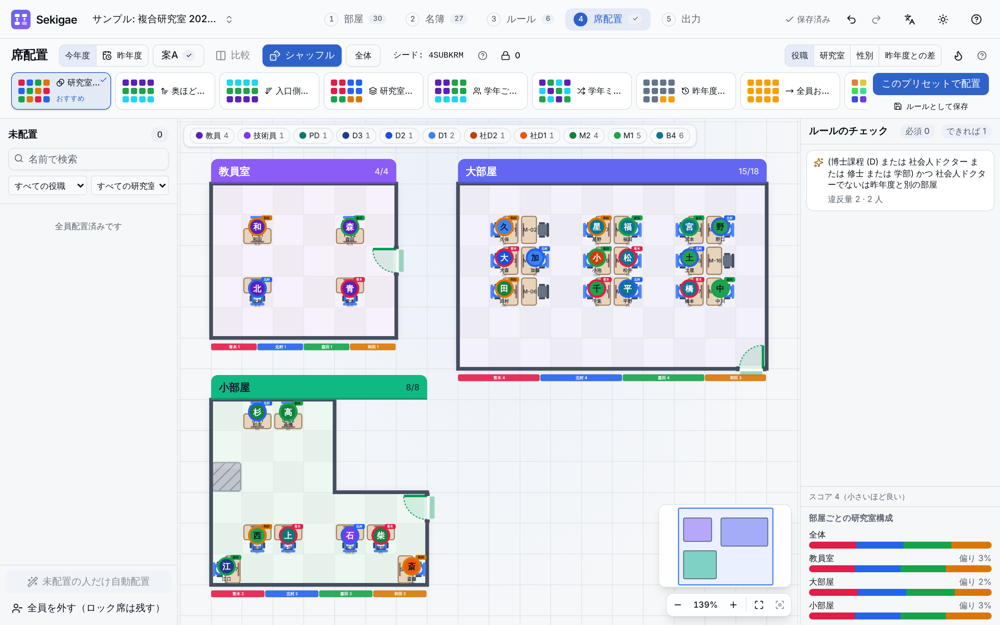
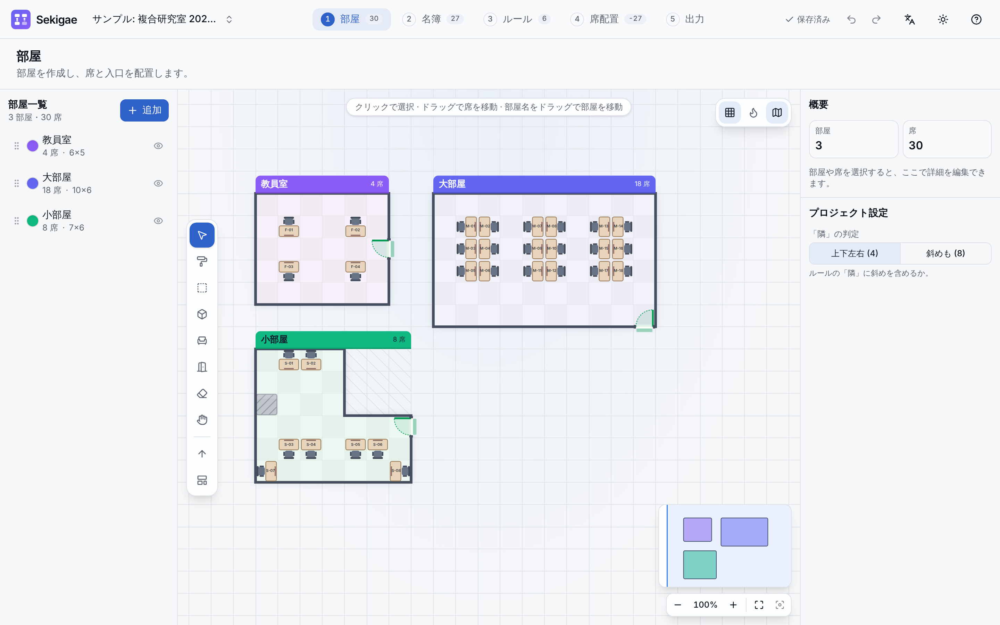

# Sekigae — seat planner for labs

[日本語](README.md) | English

Sekigae plans seating for research labs, and especially for **multi-lab rooms where several labs share the same space**. It runs entirely in the browser: there is no server and no login, and all data stays in your browser.



A step-by-step guide covers creating rooms through export, rule examples and the year rollover. It is available in Japanese: [docs/usage.md](docs/usage.md).

## Features

| Step       | What you can do                                                                                                                                                                                           |
| ---------- | --------------------------------------------------------------------------------------------------------------------------------------------------------------------------------------------------------- |
| 1. Rooms   | Draw multiple cell-based rooms, including L-shapes. Place seats, entrances and obstacles. Desk templates and a depth heatmap (distance from the entrance)                                                 |
| 2. Roster  | Name, lab, gender and role/year (faculty to B3, with **working doctoral students wd1–wd3** on a separate track). Import from Excel, CSV or paste. Last year's seats and a year-rollover wizard            |
| 3. Rules   | A custom editor that builds rules from sentence-like blocks. People and seat conditions combine with and / or / not, and rules combine with any / all / if-then. Blocks and templates for multi-lab rooms |
| 4. Seating | Presets such as "mix labs" or "seniors toward the back", seeded shuffle, drag-and-drop fine-tuning, locks, live rule violations and plan comparison                                                       |
| 5. Export  | XLSX (seat charts and roster) and PPTX (one slide per room, built from editable shapes)                                                                                                                   |

| Room editor                                                                                      | Rule editor                                                                  |
| ------------------------------------------------------------------------------------------------ | ---------------------------------------------------------------------------- |
|  |  |

Also included:

- dark, light or automatic theme
- Japanese and English UI
- first-run onboarding and a guided tour
- undo/redo
- multiple projects
- JSON backup
- offline use as a PWA

## Privacy

- Everything you enter is stored **only in this browser on this device** (localStorage). Nothing is sent anywhere, and there is no analytics.
- Clearing your browser data deletes it. Back up regularly from "Manage projects…" → "Export whole project".

## Supported environments

- Editing: current desktop Chrome, Edge, Firefox and Safari.
- Phones: view only.
- Automated tests always run on Chromium; Firefox and WebKit are covered by an optional job (see [docs/quality.md](docs/quality.md)).

## Development

Requirements: Node.js 22 or later and pnpm 10.

```bash
pnpm install
pnpm dev             # dev server
pnpm build           # type check + production build (dist/, including the PWA)
pnpm preview         # serve the build
pnpm exec vp check   # format, lint and type check (--fix to auto-fix)
pnpm test            # unit tests
pnpm e2e             # end-to-end tests (run pnpm build first)
pnpm bundle:check    # gzip size budget for the initial JS (run pnpm build first)
```

The toolchain is [Vite+](https://viteplus.dev/) (`vp`), and the UI uses React 19, Tailwind CSS v4 and shadcn/ui.

Further docs, in Japanese:

- [docs/CONTRIBUTING.md](docs/CONTRIBUTING.md): directory layout and conventions
- [docs/DESIGN.md](docs/DESIGN.md): design
- [docs/quality.md](docs/quality.md): performance and accessibility results
- [docs/release-checklist.md](docs/release-checklist.md): release steps

## Deployment

`pnpm build` writes static files only, to `dist/`. Either serve that folder from any static web server (for example a university server), or use the `dist` artifact that GitHub Actions CI saves. Asset paths are relative, so it also works from a subdirectory.

The `GitHub Pages` workflow (`.github/workflows/pages.yml`) builds `main` and publishes `dist/` to GitHub Pages. It needs one repository setting: **Settings → Pages → Build and deployment → Source: GitHub Actions**.

## License

[MIT](LICENSE)
