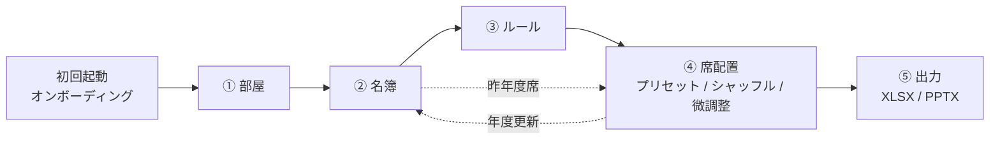

# 研究室 席決めアプリ 設計書 (Draft v0.1)

> ステータス: レビュー待ち。合意後に GitHub Issues (Epic + sub-issue) へ分解する。

## 1. 概要

研究室の年度替わりの席替えを、ブラウザだけで完結して行うアプリ。

- **クライアントサイドのみ**（サーバー無し・ログイン無し）。静的ホスティング (GitHub Pages) で配信。
- データは **localStorage** に保存し、JSON ファイルでバックアップ / 共有。
- 部屋を描く → 名簿を作る → ルールを組む → 自動配置（プリセット / シャッフル） → 手で微調整 → **XLSX / PPTX 出力**。
- リッチなグラフィック（机・椅子・ドアのイラスト、配置アニメーション、ヒートマップ）。
- ダーク / ライト / 自動、日本語 / 英語、初回オンボーディング。

### 1.1 ユーザーフロー



画面上部のナビゲーションは①〜⑤のステッパー形式（自由に行き来可能）。

---

## 2. 技術スタック

| 領域 | 採用 | 備考 |
|---|---|---|
| パッケージ管理 | **pnpm** | |
| ツールチェーン | **Vite+ (`vite-plus`, `vp`)** | `vp dev / build / test / lint / fmt`。Vite 8 + Vitest + Oxlint + Oxfmt を一括 |
| UI | **React 19** + TypeScript (strict) | |
| スタイル | **Tailwind CSS v4** | CSS 変数ベースのテーマトークン |
| コンポーネント | **shadcn/ui** (Radix) + lucide-react | |
| ルーティング | TanStack Router (hash history) | GitHub Pages で深いリンクを壊さない |
| 状態管理 | Zustand + immer + persist | |
| Undo/Redo | zundo | 部屋・名簿・ルール・配置すべて |
| スキーマ | zod v4 | 保存データ検証・インポート検証・マイグレーション |
| DnD | dnd-kit | キーボード操作対応 |
| アニメーション | motion (Framer Motion) | `prefers-reduced-motion` 尊重 |
| 描画 | **SVG** (React) + 自前 pan/zoom | セル数は高々数千なので Canvas 不要。DOM なので a11y・DnD・テーマ追従が容易 |
| 表 | TanStack Table | 名簿 |
| フォーム | react-hook-form + zod | |
| ソルバー実行 | Web Worker + Comlink | UI を止めない、進捗・キャンセル |
| i18n | i18next + react-i18next + languagedetector | ja-JP（既定）/ en |
| XLSX | ExcelJS | セル塗り・罫線・結合など**スタイル付き**出力のため (SheetJS CE はスタイル不可) |
| PPTX | PptxGenJS | 図形で描く（画像化しない → PowerPoint で編集可能） |
| 名簿取込 | ExcelJS / Papaparse | XLSX / CSV / Excel からの貼り付け |
| オンボーディング | driver.js | 軽量、React 非依存 |
| テスト | Vitest (`vp test`) + Testing Library、Playwright (E2E) | |
| CI/CD | GitHub Actions → GitHub Pages | |
| (任意) PWA | vite-plugin-pwa | オフライン利用 |

XLSX / PPTX / 取込ライブラリは **dynamic import** で遅延ロードし、初期バンドルを軽く保つ。

---

## 3. ドメインモデル

```ts
type ID = string; // nanoid

interface Project {
  schemaVersion: number;
  id: ID;
  name: string;               // 例: "2026年度 ○○研"
  createdAt: string; updatedAt: string;
  labs: Lab[];                // 所属研究室マスタ
  members: Member[];
  layout: Layout;             // 部屋群
  rules: Rule[];
  plans: SeatPlan[];          // 席配置案（今年度の案A/B… と 昨年度）
  activePlanId: ID;
  previousPlanId?: ID;        // 「昨年度」として扱う SeatPlan
  settings: ProjectSettings;  // 隣接判定(4近傍/8近傍)など
}

interface Lab { id: ID; name: string; color: string; }

type Gender = 'male' | 'female' | 'other' | 'unspecified';

type RoleKey =
  | 'faculty' | 'technician' | 'support'   // 教員 / 技術員 / 支援員
  | 'pd' | 'd3' | 'd2' | 'd1' | 'm2' | 'm1' | 'b4' | 'b3'
  | 'other';

interface Member {
  id: ID;
  name: string;
  kana?: string;              // ソート用（任意）
  labId?: ID;
  gender: Gender;
  role: RoleKey;
  tags: string[];             // 任意タグ（例: "留学生", "車椅子"）
  note?: string;
}
```

### 3.1 役職・学年マスタ（固定）

| key | ja | en | rank (シニア度) |
|---|---|---|---|
| faculty | 教員 | Faculty | 100 |
| technician | 技術員 | Technician | 90 |
| support | 支援員 | Support staff | 85 |
| pd | PD | Postdoc | 80 |
| d3 / d2 / d1 | D3 / D2 / D1 | D3 / D2 / D1 | 70 / 65 / 60 |
| m2 / m1 | M2 / M1 | M2 / M1 | 50 / 45 |
| b4 / b3 | B4 / B3 | B4 / B3 | 30 / 25 |
| other | その他 | Other | 0（並び順の対象外にもできる） |

`rank` は「奥ほど上級生」などのプリセット・ルールで使う。色も役職ごとに固定パレット（B3 → 教員で明→濃のグラデーション）。

### 3.2 部屋・レイアウト

部屋は「フロア」上に複数配置される矩形グリッド。L 字などは `void` セルで表現。

```ts
interface Layout {
  rooms: Room[];
}

interface Room {
  id: ID;
  key: ID;                    // 系譜キー。レイアウト複製時も維持（昨年度比較用）
  name: string;
  color: string;
  position: { x: number; y: number };  // フロア上の位置（セル単位）
  width: number; height: number;       // セル数（最大 40×40 程度）
  cells: CellKind[];          // width*height, row-major
  seats: Seat[];
  entrances: Entrance[];
  note?: string;
}

type CellKind = 'floor' | 'void' | 'obstacle'; // 床 / 部屋外 / 柱・棚など

interface Seat {
  id: ID;
  x: number; y: number;       // 部屋内セル座標
  facing: 'n' | 'e' | 's' | 'w';  // 机の向き（描画用）
  label: string;              // 自動採番 "A-01" 等、手動変更可
  tags: string[];             // "窓側" など。ルールのセル集合指定に使える
}

interface Entrance {
  id: ID;
  x: number; y: number;       // 外周セル
  side: 'n' | 'e' | 's' | 'w';
}
```

**派生データ（保存しない）**

- `depth(seat)`: 入口から通路（floor セル）を BFS した距離。複数入口は最短。部屋内で 0..1 に正規化した値も持つ。
  → 「奥」の定義。ヒートマップ表示・プリセット・ルールで利用。
- `adjacency`: 同じ部屋の席同士の隣接（設定で 4 近傍 / 8 近傍）。

### 3.3 席配置案 (SeatPlan)

```ts
interface SeatPlan {
  id: ID;
  name: string;               // "案A", "2025年度" など
  kind: 'current' | 'previous';
  assignment: Record<SeatID, MemberID>;   // 席 → 人
  roomOnly: Record<MemberID, RoomKey>;    // 昨年度: 席は不明だが部屋は分かる場合
  locks: SeatID[];            // 微調整で固定した席（再シャッフル対象外）
  seed?: number;              // 生成に使った乱数シード
  createdAt: string;
}
```

- 「昨年度の席」は `kind: 'previous'` の SeatPlan として **単一の真実** を持つ。名簿の「昨年度席」列も部屋ビューの昨年度モードも同じデータを編集する（= リストからも部屋配置からも再現可能）。
- 昨年度の部屋構成が今年と違う場合に備え、部屋は `key` で同一性を判定。v1 は「同じレイアウトを使う」を前提とし、別レイアウト対応は拡張 Issue とする。

---

## 4. ルール (ブロックベース)

### 4.1 方針

Blockly のような汎用プログラミングではなく、**「文章になるブロック」** を組み立てる DSL。

```
┌ 部屋 ─────────────────────────────────────── [必須 ▾] [⋯] ┐
│ [居室A ▾] には [D1, D2, D3 ▾] を [多めに ▾] 配置する              │
└─────────────────────────────────────────────────────────────┘
┌ 人 ───────────────────────────────────────── [できれば ▾ ●●○] ┐
│ [山田 太郎 ▾] と [佐藤 花子 ▾] は [別の部屋 ▾] にする              │
└─────────────────────────────────────────────────────────────┘
```

- 左にパレット（カテゴリ別・色分け: 部屋 / 席 / 人 / 全体）、右にルールのスタック。ドラッグで追加・並べ替え。
- 各ブロックは **スロット（ピル型ドロップダウン）** を持ち、型付き（部屋 / 席集合 / 人集合 / 数値 / 演算子）。
- 各ルール共通: 有効/無効、**強さ = 必須(hard) / できれば(soft, 重み 1〜5)**、メモ。
- ルールの自然文サマリー、参照切れ（削除済み部屋・人）の警告表示。
- 文の語順は言語で異なるため、ブロックのテンプレートは i18n 文字列 + スロット埋め込み（`<Trans>` コンポーネント）で定義。
- 部屋/席ビューの **右クリックメニューからもルール作成可能**（例: 席を右クリック →「この席を○○さんに固定」「この席は教員のみ」）。作られたルールはルール画面に同じく並ぶ。

### 4.2 セレクタ（スロットの型）

```ts
type PersonSelector =
  | { kind: 'all' }
  | { kind: 'members'; ids: ID[] }
  | { kind: 'filter'; roles?: RoleKey[]; labs?: ID[]; genders?: Gender[]; tags?: string[] };

type SeatSelector =
  | { kind: 'rooms'; roomIds: ID[] }
  | { kind: 'seats'; seatIds: ID[] }
  | { kind: 'seatTags'; tags: string[] }
  | { kind: 'depth'; roomIds: ID[]; from: 'back' | 'front'; count?: number; ratio?: number };
```

### 4.3 ブロック一覧（v1）

| カテゴリ | ブロック (type) | 文例 |
|---|---|---|
| 部屋 | `room.only` | [部屋] は [人集合] **のみ** |
| 部屋 | `room.prefer` | [部屋] には [人集合] を **多めに**（soft 専用） |
| 部屋 | `room.count` | [部屋] の [人集合] は [≥/≤/=] [n 人 / n %] |
| 部屋 | `room.exclude` | [部屋] には [人集合] を入れない |
| 席 | `seat.only` | [席集合] は [人集合] **のみ**（役職・学年制限） |
| 席 | `seat.pin` | [席] に [人] を **あらかじめ入れておく** |
| 席 | `seat.empty` | [席集合] は空席にする |
| 人 | `person.pin` | [人] は [席 / 部屋] に固定 |
| 人 | `person.avoid` | [人] は [席集合] にしない |
| 人 | `pair.relation` | [人集合A] と [人集合B] は [同じ部屋 / 別の部屋 / 隣 / 隣にしない] |
| 全体 | `prev.different` | [人集合] は昨年度と [別の部屋 / 別の席] |
| 全体 | `prev.same` | [人集合] は昨年度と [同じ部屋 / 同じ席] |
| 全体 | `group.cluster` | [人集合] を [研究室 / 役職] ごとに **まとめる** |
| 全体 | `group.spread` | [人集合] を [研究室 / 役職 / 性別] で部屋間に **分散** |
| 全体 | `depth.order` | [人集合] は [役職] が上がるほど [奥 / 入口側] |

```ts
interface Rule {
  id: ID;
  enabled: boolean;
  strength: 'hard' | 'soft';
  weight: 1 | 2 | 3 | 4 | 5;  // soft のみ有効
  block: RuleBlock;           // 上表の判別共用体
  note?: string;
  origin?: 'user' | 'preset' | 'contextMenu';
}
```

### 4.4 評価関数

各ブロックは純関数として実装し、**ソルバーと UI（違反表示）で同じコードを使う**。

```ts
interface RuleEvaluator<B> {
  // 単項制約 (席ドメインの絞り込み) を返せるものは返す
  unaryDomain?(block: B, ctx): Map<MemberID, Set<SeatID>> | null;
  // 違反量 (0 = 満たす)。差分計算用に影響する人/席も返す
  evaluate(block: B, assignment, ctx): { violation: number; culprits: { members: ID[]; seats: ID[] } };
}
```

---

## 5. 配置エンジン (ソルバー)

人数規模は 〜100 人・〜150 席を想定。Web Worker 上で実行。

1. **前処理**
   - ルールを正規化（セレクタ → 具体的な人/席の集合へ展開）。
   - 単項の hard ルール（固定・席制限・部屋制限・除外・空席）から **人ごとの許容席集合** を作る。
   - ロック済みの席を確定。
2. **実行可能性チェック**
   - 二部マッチング（Hopcroft–Karp）で「全員が許容席に座れるか」を判定。
   - 失敗時は Hall の定理に基づく **不足理由を提示**（例:「教員のみの席が 3 つに対して教員 4 名」）。
3. **初期解**: ランダム順の貪欲 + マッチング補修（シードで再現可能）。
4. **最適化**: 焼きなまし法 (Simulated Annealing)
   - 近傍: 2 人の入れ替え / 空席への移動（許容席内のみ）。
   - 目的関数 = Σ(hard 違反 × 大きい定数) + Σ(soft 違反 × weight) + プリセット項。
   - 差分評価で高速化。一定時間（既定 1.5 秒）または収束で終了。
5. **結果**: 配置、残った違反の一覧、スコア、シード。

- **乱数シャッフル**: シード付き PRNG (mulberry32 等)。シードを表示し、同じシードで再現可能。「もう一回」でシード変更。
- **部分シャッフル**: ロックした席・人は動かさない（微調整後に残りだけ再配置）。
- 進捗（スコア推移）を Worker から送り、UI でアニメーション表示。キャンセル可能。

---

## 6. 席配置プリセット

プリセット = **「ソフト目的関数のテンプレート」**。クリックするとソルバーを実行して即反映（hard ルールは尊重）、その後自由に手で編集できる。

| プリセット | 内容 |
|---|---|
| 奥ほど上級生 | depth と role rank の順位相関を最大化 |
| 入口側ほど上級生 | 上の逆 |
| 研究室ごとにまとめる | 同研究室を同じ部屋・隣接に |
| 学年ごとにまとめる | 同役職を隣接に |
| 学年ミックス | 隣接する人の役職が異なるほど良い |
| 昨年度を維持 | 昨年度と同じ席を最大化 |
| 全員お引越し | 昨年度と別の部屋を最大化 |
| 名前順 | 席ラベル順に五十音（kana）順 |
| 完全ランダム | 目的関数なし（hard のみ） |

- プリセットはサムネイル付きカードのギャラリーで提示（ホバーで実際の部屋に対するプレビュー）。
- プリセットを「ルールとして保存」すると `depth.order` 等の soft ルールとしてルール一覧に追加される。

---

## 7. 画面設計

### 7.1 共通シェル

- ヘッダー: プロジェクト切替 / 保存状態（保存済み・保存中）/ Undo・Redo / 言語 / テーマ（ライト・ダーク・自動）/ ヘルプ（ツアー再生・ショートカット一覧）。
- ステッパーナビ: ① 部屋 ② 名簿 ③ ルール ④ 席配置 ⑤ 出力。各ステップに完了度バッジ（例: 名簿 24 人、未配置 3 人）。
- レスポンシブ: 主対象はデスクトップ。タブレットは閲覧・簡易編集、スマホは閲覧のみ。

### 7.2 ① 部屋エディタ

- **フロアキャンバス**: 無限グリッド上に部屋を配置。ドラッグで移動、ハンドルでリサイズ。ホイールでズーム、スペース+ドラッグでパン、ミニマップ。
- **ツールパレット**: 選択 / 床 / 部屋外(void) / 障害物 / 席 / 入口 / 消しゴム / 範囲選択。ドラッグで連続ペイント。
- **席**: 机+椅子のトップビューイラスト、向き（R キーで回転）、自動採番、タグ付け。
- **テンプレート挿入**: 島型 (2×2, 2×3)、壁沿い一列、教室型。
- **インスペクタ**（右パネル）: 部屋名・色・メモ・席数、選択席のラベル・向き・タグ。
- **奥行きヒートマップ** オーバーレイ（入口からの距離を色で可視化）。
- 部屋リスト（左パネル）: 追加・複製・削除・並べ替え・表示切替。
- コピー&ペースト、Delete、矢印キー移動、Undo/Redo。

### 7.3 ② 名簿

- TanStack Table: 氏名 / ふりがな / 研究室 / 性別 / 役職・学年 / タグ / **昨年度の席（部屋・席のコンボボックス）** / メモ。
- 検索・ソート・フィルタ、インライン編集、複数選択の一括編集・削除。
- 研究室マスタ管理（名前・色）。
- **一括取込**: CSV / XLSX / Excel からの貼り付け → 列マッピング UI → プレビュー → 取込。役職の表記ゆれ（"修士1年", "M1", "m1"）を正規化。
- **年度更新ウィザード**: 今年度の確定案 → 昨年度へ移行、学年の一括進級（B3→B4→M1…、M2/D3/B4 卒業者の選択的削除）。

### 7.4 ③ ルール

- 4 章のブロックエディタ。
- 右上に **実行可能性インジケータ**（hard ルールが満たせるかをリアルタイムチェック）。
- ルールの JSON エクスポート / インポート（他プロジェクトへ流用）。

### 7.5 ④ 席配置

- 部屋群を描画し、席に **メンバーチップ**（アバター = 名前の頭文字、役職カラー、研究室カラーの縁取り）。
- 左: **未配置トレイ**（フィルタ付き）。右: **違反パネル**（ルールごとの違反・該当席を発光ハイライト、クリックでジャンプ）。
- 上部: プリセットギャラリー、**シャッフルボタン**（シード表示・再現）、配置案の切替/複製/比較（案A/案B）。
- 操作: ドラッグで移動、席同士で **入れ替え**、トレイへ戻す、ロック（🔒）、右クリックメニュー（固定ルール化など）。キーボードでも操作可能。
- **色分けモード**: 役職 / 研究室 / 性別 / 昨年度との差分（残留・移動・新規）。凡例付き。
- **昨年度モード**: 同じキャンバスで昨年度 SeatPlan を編集（部屋配置から昨年度を再現）。
- シャッフル時は motion の layout アニメーションでチップが席間を飛ぶ演出（reduced-motion 時は無効）。
- ホバーカードでメンバー詳細と、その人に関わるルール一覧。

### 7.6 ⑤ 出力

出力ダイアログ: 対象案・対象部屋・言語・含める列・色分け有無を選択 → ダウンロード。

- **XLSX** (ExcelJS)
  - シート「座席表_部屋名」: 部屋グリッドをセルで再現（席セルに氏名・役職、色塗り、入口・障害物記号、印刷範囲・横向き設定）。
  - シート「名簿」: 氏名 / 研究室 / 性別 / 役職 / 部屋 / 席ラベル / 昨年度部屋 / 昨年度席。オートフィルタ。
  - シート「部屋別一覧」: 部屋ごとのメンバー。
- **PPTX** (PptxGenJS)
  - 表紙 → 全体フロア図 1 枚 → 部屋ごとに 1 枚。席は角丸矩形、入口はドア記号、すべて **編集可能な図形**。
  - 日本語フォント指定（游ゴシック / Meiryo、en 時は Arial 等）、16:9。
- (任意) PNG 画像・印刷用 CSS。
- **JSON**: プロジェクト全体バックアップ（永続化 Epic）。

### 7.7 オンボーディング

1. 初回起動で **ウェルカムダイアログ**: 「サンプルで試す」/「空から始める」/「バックアップを読み込む」+ 言語・テーマ選択。
2. **ガイドツアー**（driver.js）: ステッパー → 部屋エディタのツール → 名簿取込 → ルールブロック → シャッフル → 出力。各ステップでスキップ可能、ヘルプメニューから再生。
3. 各画面の **空状態** に次のアクション（例:「まず部屋を作りましょう」+ テンプレート部屋ボタン）。
4. サンプルプロジェクト: 3 部屋・約 30 名（架空の名前）・数個のルール。
5. キーボードショートカット一覧ダイアログ（`?` キー）。

---

## 8. 永続化

- キー設計: `sekigae:v1:index`（プロジェクト一覧メタ）、`sekigae:v1:project:<id>`（本体）、`sekigae:v1:prefs`（テーマ・言語・オンボーディング完了フラグ）。
- 変更を **デバウンス自動保存**（500ms）。ヘッダーに保存状態表示。
- `schemaVersion` + zod 検証 + 逐次マイグレーション関数。読み込み失敗時は退避キーにバックアップして復旧ダイアログ。
- 容量超過 (QuotaExceededError) のハンドリングと警告。
- 複数プロジェクト: 新規 / 名前変更 / 複製 / 削除。
- **JSON エクスポート / インポート**: プロジェクト全体、部屋レイアウトのみ、名簿のみ、ルールのみ。
- 複数タブ同時編集: `storage` イベントで検知し「他のタブで更新されました」通知。

---

## 9. テーマ / i18n

- **テーマ**: `light | dark | system`。`<html class="dark">` 切替（shadcn 方式）、`matchMedia` 追従。初期描画のちらつき防止スクリプトを `index.html` に。キャンバスの色（床、壁、席、ヒートマップ、役職パレット）も CSS 変数トークン化し両テーマで調整。
- **i18n**: i18next。既定はブラウザ言語検出（ja 以外は en）、手動切替を prefs に保存。
  - 名前空間: `common`, `rooms`, `members`, `rules`, `seating`, `export`, `onboarding`。
  - キーは型安全（`i18next` の型拡張）。CI で ja/en のキー差分をチェック。
  - 役職名・ルール文テンプレート・出力ファイル内の見出しも翻訳対象。

---

## 10. ディレクトリ構成（案）

```
src/
  app/            # ルーター, レイアウト, プロバイダ (theme, i18n)
  components/ui/  # shadcn 生成物
  components/     # 共通コンポーネント
  domain/         # 型, zod スキーマ, 役職マスタ, 幾何 (depth, adjacency)
  store/          # zustand slices, persist, migrations
  features/
    rooms/        # 部屋エディタ
    members/      # 名簿, 取込, 年度更新
    rules/        # ブロックエディタ, ブロック定義
    seating/      # 席配置ビュー, プリセット
    export/       # xlsx, pptx
    onboarding/
  engine/         # ルール評価, ソルバー, worker
  graphics/       # SVG アセット (机, 椅子, ドア), カラートークン
  i18n/           # locales/ja/*.json, locales/en/*.json
  lib/            # rng, id, utils
tests/e2e/        # Playwright
```

`engine/` と `domain/` は React 非依存の純 TypeScript にし、単体テストを厚くする。

---

## 11. 品質・非機能

- a11y: すべての DnD にキーボード代替、フォーカスリング、色だけに頼らない（チップに役職テキスト）。
- パフォーマンス: 100 人・150 席でドラッグ 60fps、シャッフル 2 秒以内。
- テスト: engine は網羅的な単体テスト（各ルールの評価・実行不能検出・シード再現）、主要フローは Playwright E2E。
- プライバシー: 個人情報は端末内のみ。外部送信なし（アナリティクスも入れない）を README に明記。

---

## 12. 未決事項（レビューで決めたい点）

1. ルールエディタは **自前の「文章ブロック」UI**（推奨）か、**Google Blockly** か。
2. 昨年度と今年度で **部屋レイアウトが変わるケース** を v1 で扱うか（推奨: v1 は同一レイアウト、拡張で対応）。
3. 「性別」の選択肢（男性 / 女性 / その他 / 未回答 で良いか）と、性別をルール・色分けに使うことの可否。
4. 配置案（案A/案B）の複数保持と比較機能を v1 に含めるか（推奨: 含める、比較 UI は後回し）。
5. デプロイ先は GitHub Pages で良いか。PWA（オフライン）を v1 に含めるか。
6. スマホ対応の範囲（推奨: 閲覧のみ）。

---

## 13. Issue 分解方針

Epic（親 Issue）ごとに、1 PR で完結する粒度の sub-issue を作成する。

| # | Epic | 主な sub-issue |
|---|---|---|
| E0 | プロジェクト基盤 | Vite+ 雛形 / Tailwind+shadcn / lint・fmt・test / CI / Pages デプロイ / AppShell・ルーティング / Playwright |
| E1 | ドメインモデル・状態管理 | 型+zod / 役職マスタ / store slices / undo-redo / RNG・ID / depth BFS / 隣接計算 |
| E2 | 永続化 | storage adapter / マイグレーション / 自動保存+状態表示 / 複数プロジェクト / JSON 入出力 / 部分入出力 / エラー復旧 / 複数タブ |
| E3 | テーマ・i18n | ThemeProvider / キャンバスカラートークン / i18next 基盤 / 言語切替 / ja・en 辞書 / キー差分 CI |
| E4 | 部屋エディタ | キャンバス pan/zoom / 部屋 CRUD / 移動・リサイズ / セルペイント / 席配置・向き・採番 / 入口 / 選択・コピペ / テンプレート / インスペクタ / ヒートマップ / ショートカット / SVG アート |
| E5 | 名簿 | テーブル / 追加編集フォーム / インライン編集 / 研究室マスタ / 一括編集 / CSV・XLSX 取込 / 貼り付け取込 / 表記ゆれ正規化 |
| E6 | 昨年度席・年度更新 | 昨年度プラン / リストから入力 / 部屋ビューから入力 / 部屋のみ指定 / 差分表示 / 年度更新ウィザード |
| E7 | ルールエディタ | ブロック基盤 UI / スロット (人・席・部屋・数値) / パレット+DnD / 共通設定 (hard/soft/重み/有効) / ブロック種別ごと実装 / 右クリック作成 / 参照切れ検知 / 自然文サマリー / 入出力 |
| E8 | 配置エンジン | ルール評価器 / 正規化 / 実行可能性チェック+理由提示 / 初期解 / 焼きなまし / ロック・部分再配置 / Worker+進捗・キャンセル / テスト・ベンチ |
| E9 | 席配置ビュー | チップ描画 / 未配置トレイ / DnD 移動・入替 / キーボード操作 / ロック / シャッフル+アニメ / 違反パネル+ハイライト / 色分け+凡例 / ホバーカード / プリセットギャラリー / 各プリセット / 配置案管理 |
| E10 | 出力 | 出力ダイアログ / XLSX 座席表 / XLSX 名簿・部屋別 / PPTX 部屋スライド / PPTX 全体図・表紙 / フォント・遅延ロード / (任意) PNG・印刷 |
| E11 | オンボーディング | ウェルカム / サンプルデータ / ガイドツアー / 空状態 / ヘルプ・ショートカット |
| E12 | 品質・リリース | a11y 監査 / E2E シナリオ / パフォーマンス計測 / PWA / README・プライバシー表記 |
