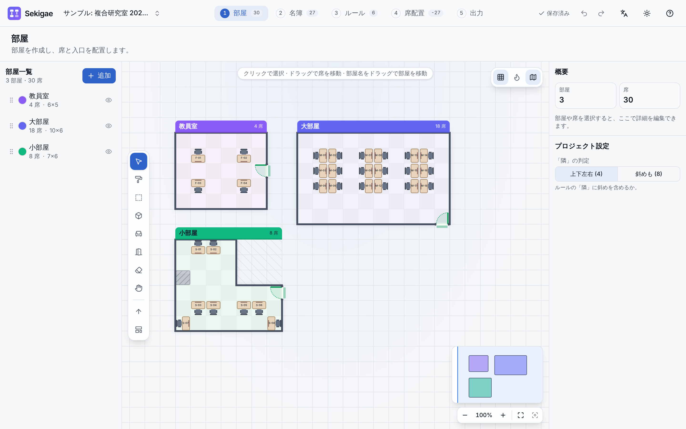
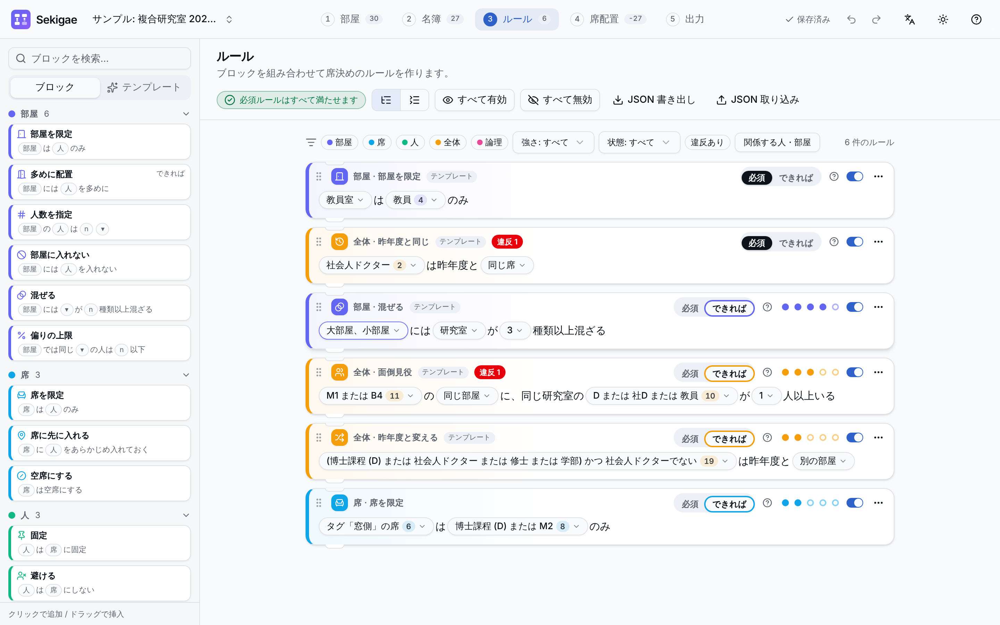
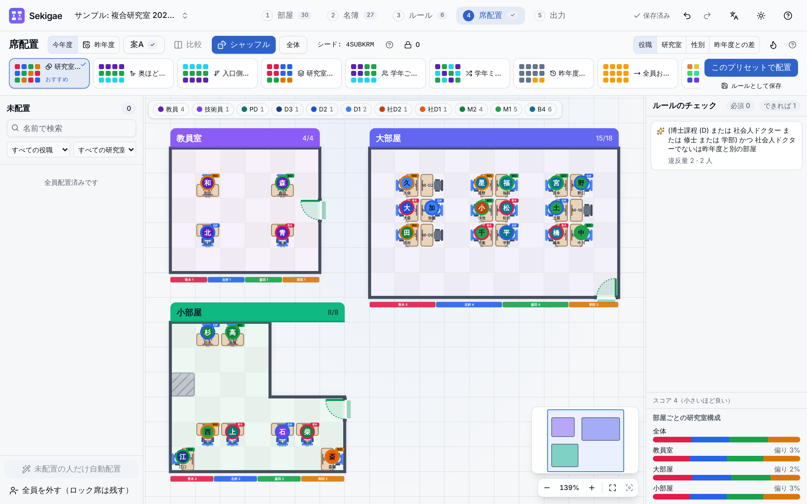

# 使い方ガイド

Sekigae は、画面上部の 5 つのステップ **① 部屋 → ② 名簿 → ③ ルール → ④ 席配置 → ⑤ 出力** の順に進めて席を決めるアプリです。どのステップにもいつでも戻れます。

- 初めて開くとウェルカム画面が出ます。「サンプルで試す」を選ぶと、複合研究室のサンプル（3 部屋・約 30 名・4 研究室）で一通り操作できます。
- 右上の「？」→「ガイドツアーを見る」で、いつでも画面の案内を再生できます。`?` キーでショートカット一覧を表示します。
- すべての操作は「元に戻す / やり直す」（`Ctrl/⌘ + Z`、`Ctrl/⌘ + Shift + Z`）で取り消せます。
- データは自動でこのブラウザに保存されます（[バックアップ](#バックアップとプロジェクト)も参照）。

## ① 部屋をつくる

1. 左の「部屋一覧」で **＋追加** を押し、名前と大きさ（空の部屋 / 小部屋 / 中部屋 / 大部屋）を選びます。
2. 左側のツールでセルを編集します。

   | ツール      | 使い方                                                                     |
   | ----------- | -------------------------------------------------------------------------- |
   | 選択        | クリックで選択、ドラッグで席の移動や範囲選択。部屋名をドラッグで部屋を移動 |
   | 床 / 部屋外 | 部屋外にすると L 字などの形を作れます（`Shift` + ドラッグで矩形）          |
   | 障害物      | 柱・棚など、席を置けないセル                                               |
   | 席          | クリックで席を置く / 外す。ドラッグで連続配置                              |
   | 入口        | 部屋の外周の辺に置きます。「奥行き」（入口からの距離）の基準になります     |
   | 消しゴム    | 席・入口・障害物を消します                                                 |

3. 「席のテンプレート」（島型 2×2〜2×4、壁沿い一列、教室型）を選んでキャンバスをクリックすると、机をまとめて置けます。配置中は `R` で回転します。
4. 席を選ぶと右の「インスペクタ」でラベル・向き・タグ（例: 窓側）を編集できます。タグはルールで「タグ『窓側』の席」のように使えます。
5. 右上のボタンで **奥行きヒートマップ** を表示すると、入口から遠い席ほど濃く表示されます。

> 「隣」の判定（上下左右のみ / 斜めも含む）は、右の「プロジェクト設定」で切り替えます。

## ② 名簿をつくる

1. **メンバーを追加** で 1 人ずつ追加するか、**取り込む** で Excel（.xlsx）/ CSV / 貼り付けから一括で取り込みます。
   - 取り込み時は列の対応（氏名・研究室・役職/学年・性別・タグ・昨年度の部屋・席）を自動で推定し、プレビューで確認できます。
   - 「ｍ１」「修士2年」「社会人D1」などの表記ゆれは自動で正規化されます。
2. 表のセルをダブルクリック（または `Enter` / `F2`）でその場で編集できます。矢印キーと `Tab` でセル間を移動します。複数行を選ぶと、研究室の変更・タグの追加と削除・昨年度の席のクリアなどを一括で行えます。
3. **研究室** で研究室の名前・略称・色を管理します。複合研究室ではこの色が席配置や出力の色分けに使われます。
4. 役職・学年は 教員 / 技術員 / 支援員 / PD / D3〜D1 / **社D3〜社D1（社会人ドクター）** / M2 / M1 / B4 / B3 / その他 です。社会人ドクターは一般の D とは別枠で進級します。

### 昨年度の席

「昨年度と別の部屋」などのルールや差分表示のために、昨年度の席を入れておけます。次の 2 通りの入力は連動しています。

- **名簿から**: 「昨年度の席」列で部屋と席を選びます（席が分からなければ部屋だけでも可）。
- **部屋の図から**: ④ 席配置で「昨年度」に切り替え、ドラッグで昨年度の配置を再現します。

### 年度更新

年度が替わったら **年度更新** ウィザードを使います。

1. **昨年度へ移行**: 今年度の確定案を「昨年度」として保存します。
2. **進級・卒業**: 学年を一括で進級し、卒業・修了する人を選んで名簿から外します。社会人ドクターは別トラックで進級します。
3. 「社会人ドクターの席を引き継いで固定」をオンにすると、昨年度と同じ席に置いてロックし、必須ルールも追加します。

ウィザード全体は「元に戻す」1 回で取り消せます。

## ③ ルールを書く

ルールは文章になるブロックで組み立てます。左のパレットからクリックで追加（またはドラッグで挿入）し、`[ ]` の部分を選んで埋めます。

| カテゴリ | 例                                                                                                              |
| -------- | --------------------------------------------------------------------------------------------------------------- |
| 部屋     | 「[教員室] は [教員] のみ」「[大部屋] には [研究室] が [3] 種類以上混ざる」                                     |
| 席       | 「[タグ『窓側』の席] は [D または M2] のみ」「[席 A-01] に [山田さん] をあらかじめ入れておく」                  |
| 人       | 「[Aさん] は [Bさん] と別の部屋」「[Cさん] は [席] に固定」                                                     |
| 全体     | 「[学生] は昨年度と [別の部屋]」「[M1 または B4] の同じ部屋に、同じ研究室の [D または 教員] が [1] 人以上いる」 |
| 論理     | 「次の [いずれか / すべて] を満たす」「もし 〜 なら 〜」                                                        |

- **必須 / できれば**: 必須は必ず守り、できればは重み（●の数）に応じてなるべく守ります。
- **人・席の条件**: 「かつ / または / でない」を組み合わせられます（例: 「(D または M2) かつ 山田研」）。
- **テンプレート** タブには、よく使うルールがまとまっています（社Dは昨年度の席に固定、各部屋に3研究室以上混ぜる、1部屋の同じ研究室は半分以下、隣は別の研究室、昨年度と別の部屋 など）。
- 上部のバッジで「必須ルールはすべて満たせます」かどうかを常に確認できます。満たせない場合は不足の理由が表示されます。
- 部屋や人を削除して参照が切れたルールは、上部の注意から一括で修正できます。
- ルールは JSON で書き出し / 取り込みでき、別のプロジェクトへ流用できます。

## ④ 席を配置する

1. 上部の **プリセット** を選び **このプリセットで配置** を押すと、ルールを守ったうえで即座に配置します。

   | プリセット                      | 内容                                                                               |
   | ------------------------------- | ---------------------------------------------------------------------------------- |
   | 研究室ミックス                  | 各部屋の研究室の比率を全体に近づけ、隣同士は別の研究室（複合研究室向け・おすすめ） |
   | 奥ほど上級生 / 入口側ほど上級生 | 入口からの距離に応じて役職・学年を並べる                                           |
   | 研究室ごと / 学年ごとにまとめる | 同じ研究室・学年を近くに集める                                                     |
   | 学年ミックス                    | 隣同士の役職・学年がなるべく異なるようにする                                       |
   | 昨年度を維持 / 全員お引越し     | 昨年度と同じ席 / 別の部屋にする                                                    |
   | 名前順 / 完全ランダム           | 席番号順にふりがな順 / 必須ルールだけ守ってランダム                                |

   「ルールとして保存」でプリセットの方針をルールに追加し、後から編集することもできます。

2. **シャッフル** で別の配置を試せます。範囲は「全体 / 選んだ部屋 / 未配置の人だけ」から選べます。シードの値を入れると同じ配置を再現できます。
3. **微調整**: 人のチップをドラッグして席を入れ替えます。左の「未配置」へドラッグすると席から外れます。キーボードでも、矢印キーで席を移動し `Enter` で選んで別の席で `Enter` で置けます。
4. **ロック**: チップを右クリック →「ロック」（または `L` キー）で、その席をシャッフルしても動かないようにします。
5. 右の **ルールのチェック** に違反がリアルタイムで表示されます。項目をクリックすると該当の席に移動します。その下に部屋ごとの研究室構成と偏りが表示されます。
6. **配置案**: 「案A」メニューから案の複製・名前変更・確定ができます。**比較** で 2 案を並べ、席が変わる人・スコア・ルールの満たし方を比べられます。

> スマートフォンでは席配置を閲覧のみできます（名前で検索可）。

## ⑤ 出力する

**出力** 画面で次を選び、ダウンロードします。

- **形式**: Excel（座席表・名簿・部屋別一覧）/ PowerPoint（表紙・全体図・部屋ごとのスライド。図形のまま編集できます）/ PNG 画像。印刷もできます。
- **配置案**（確定 / 編集中 / 昨年度）、**対象の部屋**、**出力言語**（日本語 / English）
- **含める項目**（役職・研究室・性別・昨年度の席・メモ）と **色分け**（役職 / 研究室 / 性別 / なし）
- オプション: 全部屋を配置したフロアシート（Excel）、部屋ごとの構成表スライド（PowerPoint）

## バックアップとプロジェクト

- 画面左上のプロジェクト名から、プロジェクトの切り替え・新規作成・複製・削除ができます。
- 「プロジェクトを管理…」→ **JSON で書き出し** で、プロジェクト全体をファイルに保存できます。部屋レイアウト・名簿・ルールだけを書き出して別のプロジェクトに読み込むこともできます。
- データはこの端末のブラウザにのみ保存され、外部には送信されません。ブラウザのデータを消すと失われるので、定期的に書き出してください。保存容量（約 5MB）の使用量も同じ画面で確認できます。
- 同じプロジェクトを複数のタブで開いて編集すると、上書きを防ぐために警告が表示され自動保存が一時停止します。
